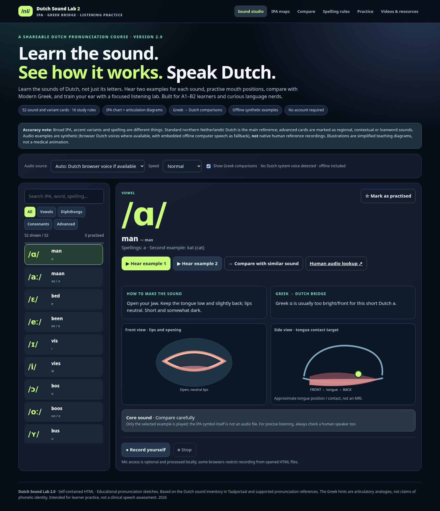

# Dutch Sound Lab 2.0

An interactive Dutch IPA and pronunciation-learning application designed for learners of Dutch, including optional comparisons for native Greek speakers.

## Features

- Browse Dutch IPA vowels, diphthongs, consonants, and clearly labelled pronunciation variants.
- Explore mouth and tongue-position illustrations and written articulation guidance.
- Play sample sounds and example words; compare commonly confused Dutch sounds.
- Practise recognition with listening exercises.
- Enable Greek-to-Dutch pronunciation comparisons.
- Practise speaking using browser microphone recording where supported.
- Mark sounds as practised and export progress.
- Consult external reference material linked in the app.

## 🌐 Live Demo

**Try Dutch Sound Lab 2.0 online:**

[Launch Dutch Sound Lab](https://george-drg.github.io/dutch-sound-lab/)

Explore Dutch IPA sounds, listen to pronunciation examples, compare sounds, and practise with interactive exercises.

## Run locally

Download `index.html` and open it in a modern browser. There is no build step or dependency installation. The app is a single-page static site.

The bundled sample sounds are synthesized; they are intended as learning aids, not a substitute for native-speaker recordings. External linked pronunciation/video resources require internet access. Microphone features require user permission and can behave differently on local files versus HTTPS.

## Deploy with GitHub Pages

1. Make the repository public (for free GitHub Pages on GitHub Free).
2. Add `index.html`, `preview.png`, `README.md`, and `.nojekyll` to the root of the `main` branch.
3. Go to **Settings → Pages**.
4. Select **Deploy from a branch**, **main**, and **/(root)**; select **Save**.
5. Open the Pages link shown in Settings. Later updates to `main` are automatically republished.

See the [official GitHub Pages guide](https://docs.github.com/en/pages/getting-started-with-github-pages/configuring-a-publishing-source-for-your-github-pages-site).

## Privacy and limitations

This version runs in the browser with no application backend. Practice preferences are stored in the user's browser; recordings are handled locally by the browser and are not uploaded by the app. Links to outside resources leave the application. The speech examples are synthetic, and pronunciation and regional variants should be checked against trusted native-speaker recordings.

## Contributions and attribution

Created as a Dutch-learning and web-development project with AI assistance. Suggestions, corrections, and sound-quality feedback are welcome through GitHub Issues.

## Licensing

No open-source license is included yet. If you want others to copy, modify, or redistribute the code, select an explicit license after reviewing the rights to any included assets. The repository being public alone does not grant these permissions.
